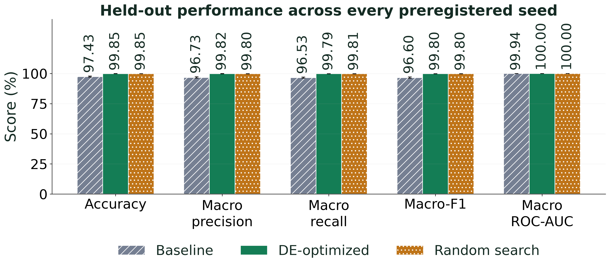
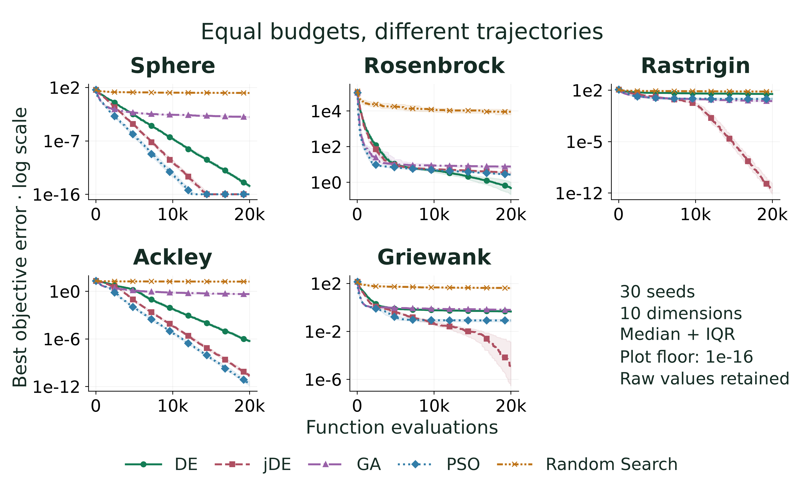
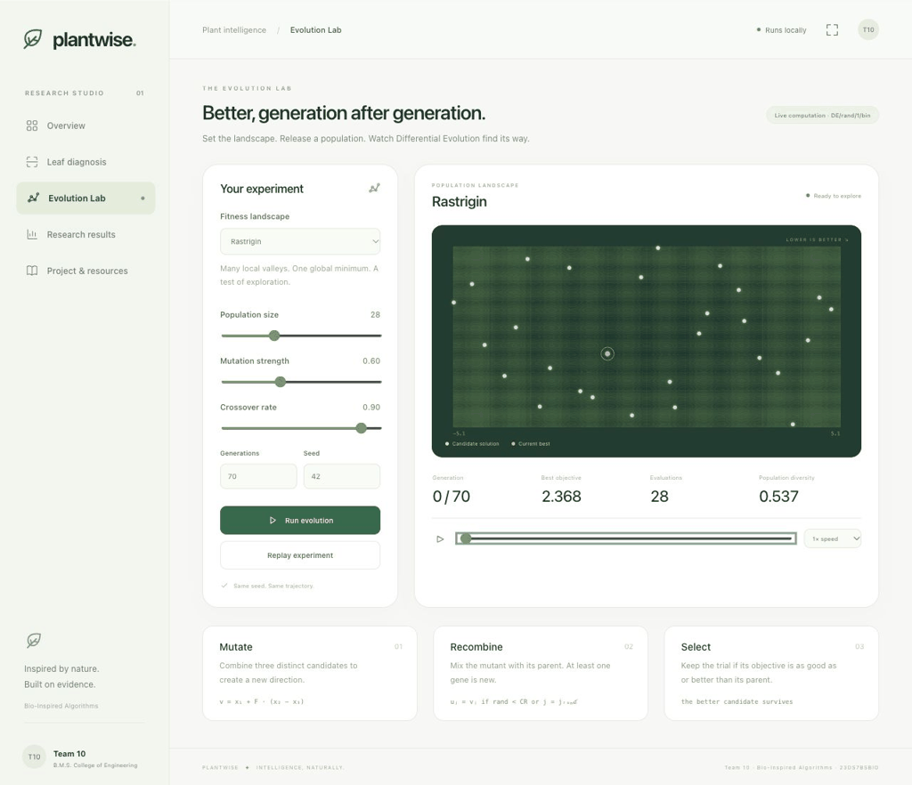

# Plantwise · Intelligence, naturally.

**Plant Disease Detection using Transfer-Learning CNN Optimized with Differential Evolution**

Bio-Inspired Algorithms · **23DS7BSBIO** · **Academic Year 2026–2027** · Team 10

A complete, offline tomato-leaf research studio: ImageNet-pretrained EfficientNet-B0, a hand-written NumPy DE/rand/1/bin optimizer, equal-budget random-search control, leakage-aware data preparation, repeated training, statistical evaluation, Grad-CAM and an animated botanical interface. The fixed task is the ten-class PlantVillage tomato subset.

[](https://github.com/Suraj-B12/BIO-INSPIRED-ALGO---AAT/actions/workflows/ci.yml)


## Measured results

| Model | Accuracy (%) | Precision (%) | Recall (%) | Macro-F1 (%) | ROC-AUC (%) |
|---|---:|---:|---:|---:|---:|
| Baseline (pre-registered) | 97.43 ± 0.45 | 96.73 ± 0.61 | 96.53 ± 0.48 | 96.60 ± 0.54 | 99.94 ± 0.02 |
| Random search | 99.85 ± 0.04 | 99.80 ± 0.05 | 99.81 ± 0.07 | 99.80 ± 0.06 | 100.00 ± 0.00 |
| DE-optimized | 99.85 ± 0.06 | 99.82 ± 0.10 | 99.79 ± 0.10 | 99.80 ± 0.09 | 100.00 ± 0.00 |

Mean ± sample standard deviation across all 3 seeds; 2,722 held-out images. Exact seed-zero McNemar p = 9.04832e-15 compares baseline with DE; it does not test DE against random search.

DE and random search tied at **99.853% mean clean accuracy**, versus 97.428% for the fixed baseline; this study does not establish DE superiority over random search. The improvement came with tradeoffs: seed-zero DE mean accuracy across the 15 corruption conditions was **69.19%**, below the baseline's **85.77%**. Its seed-zero expected calibration error was also worse: **9.23% versus 0.81%** (lower is better). These controlled-condition results do not establish field reliability.



Optimizer study: **750 trials**, **15,000,000 objective evaluations**; five methods, five functions, 30 seeds and 20,000 evaluations per trial. All raw trial records and summaries are saved. Different algorithms lead on different functions; DE is not presented as a universal winner.



## Start the offline demo

Use Python 3.11 and Git. Node.js 22 or later is needed only for the frontend regression tests. Dependencies and ImageNet initialization are downloaded during setup/training; the prepared demo then runs without an internet connection. Model inference uses the exact baseline/de seed-zero checkpoints. Images never leave the local server.

For a GitHub checkout:

```bash
git clone https://github.com/Suraj-B12/BIO-INSPIRED-ALGO---AAT.git
cd BIO-INSPIRED-ALGO---AAT
```

For the complete delivery ZIP, extract it and open a terminal in its containing folder. Skip the clone commands above and enter the extracted project:

```bash
cd Plantwise
```

Then install and start the demo from that project folder:

macOS / Linux:

```bash
python3.11 -m venv .venv
source .venv/bin/activate
python -m pip install -r requirements.txt
python demo/serve.py
```

Windows PowerShell:

```powershell
py -3.11 -m venv .venv
.\.venv\Scripts\python.exe -m pip install -r requirements.txt
.\.venv\Scripts\python.exe demo/serve.py
```

The Windows commands use the virtual environment directly, so PowerShell activation is unnecessary. For the later reproduction commands, use `.\.venv\Scripts\python.exe` wherever `python` appears.

Open **http://127.0.0.1:8000**. Press **P** for presentation mode. In Evolution Lab, **Space** pauses/resumes the animation; the timeline lets you inspect any generation. Upload JPEG, PNG or WebP images up to 12 MB / 24 megapixels. Corrupt and unsupported inputs return readable errors. The research model does not detect whether an upload is actually a tomato leaf.

For CUDA, first use the matching official PyTorch wheel command from [pytorch.org](https://pytorch.org/get-started/locally/). Device selection is CUDA → Apple MPS → CPU. `PYTORCH_ENABLE_MPS_FALLBACK=1` is set before torch imports. Data-loader workers default to zero for Windows/macOS compatibility. Offline inference always uses CPU and supports concurrent users through a serialized explanation step.



## Reproduce without retraining

```bash
python scripts/09_figures.py
python scripts/10_make_tables.py
python scripts/11_build_pptx.py
python scripts/12_export_pdfs.py --offline-citations
```

All charts are regenerated from committed `results/`, including saved qualitative pixels. Raw images and training are unnecessary for figure regeneration. Report compilation requires Tectonic; slide PDF export requires LibreOffice. Make both programs available on PATH. On Windows, add the installed LibreOffice `program` folder (typically `C:\Program Files\LibreOffice\program`) to PATH if its command is not found. `--offline-citations` rechecks current bibliography values against previously verified source records; omit it for fresh network verification.

## Reproduce the full experiment

```bash
python run_all.py
python run_all.py --from 04 --to 07
python run_all.py --smoke
python -m pytest -q
node --test tests/frontend.test.cjs
python scripts/run_checks.py
```

`scripts/run_checks.py` runs the Python tests, frontend tests and offline smoke check together, retaining their actual counts and logs in `results/test_report.json` and `results/checks/`. It refuses a passing summary if any phase fails or the source changes during verification.

The full study is resumable and takes hours, depending on hardware. `--smoke` (also `--quick`) uses synthetic images and never creates final scientific metrics. The system check measures training throughput and selects a proxy tier. `compute.allow_extended_final_training` records the approved longer final-training window. All three final recipes receive the same full-resolution epoch budget and early-stopping rule. On a new machine, every required model is trained or reused only after its recipe/protocol fingerprint matches.

The dataset source is [spMohanty/PlantVillage-Dataset](https://github.com/spMohanty/PlantVillage-Dataset), color variant. Its recorded source commit is `7f7ecc7e1eaca78107e3affe7cb5abd9427e139a`. Preparation verified 18,160 files, removed 14 exact duplicates, retained 18,146 images and grouped perceptually similar leaves before a deterministic 70/15/15 split. Split CSVs are versioned; raw data and caches are excluded.

## Research safeguards

- The baseline recipe is pre-registered before optimization: frozen backbone, a 256-unit head, dropout 0.2, Adam at 1e-3, zero weight decay and label smoothing, and the common random-crop/flip pipeline without RandAugment.
- Search and higher-fidelity re-ranking use validation data only. Only `07_evaluate.py` opens held-out image data for final assessment under a frozen protocol. An evaluation lock prevents silently replacing checkpoints after seeing test outcomes.
- Every evaluation checkpoints state and random generators. Crashes between log writes reconcile from the durable event ledger.
- All seeds are reported. Bootstrap intervals, exact McNemar comparison, calibration and corruption robustness are saved alongside clean accuracy.
- PlantVillage is a controlled-condition dataset. These results do not establish field reliability. Grad-CAM shows contributing regions, not causal proof. Consult an agricultural extension officer for crop-health decisions.

## Evidence and artifacts

| Artifact | Location |
|---|---|
| Full LaTeX report + PDF | `report/` |
| Presentation + PDF, with speaker notes | `slides/` |
| Measured JSON/CSV, model predictions and source records | `results/` |
| Reproducible PNG/vector figures | `figures/` |
| Offline application and example leaves | `demo/` |
| Optimizers, data, model and training helpers | `bioalgo/` |
| Numbered end-to-end pipeline | `scripts/`, `run_all.py` |
| Operator, model, data, API and client regression tests | `tests/` |
| Literature review, presentation script, viva answers, independent audit | `docs/` |

`final_metrics.json` schema: `models.<baseline|de|rs>.aggregate.<metric>.{mean,std}`, `per_seed`, recipe `config`, plus `class_names`, `test_images`, `seeds`, `mcnemar`, `relative_error_reduction`, `robustness`, `roc`, and the frozen `protocol`. `report_numbers.json` maps generated numeric macros back to their evidence sources. The test count and actual environment are in `test_report.json` and `system_info.json`.

CI is configured for Ubuntu, macOS and Windows. Local checks are recorded separately; a configured workflow is not a claim that remote CI has run. Recorded source revision: `5e28dddf82207bc0adb39cafb82d205a15e68d8f` (provenance: `project_git_head`). Git HEAD verified for this project at generation time. This revision does not substitute for artifact hashes: the exact delivered files are identified in `results/delivery_manifest.json`.

## Team and academic details

B.M.S. College of Engineering, Bull Temple Road, Basavangudi, Bangalore - 560019 (Autonomous College under VTU). Department of Computer Science & Engineering (Data Science).

| Name | USN |
|---|---|
| Aryanraj S Singh | 1BM23CD008 |
| Richik Chaudhuri | 1BM23CD050 |
| Suraj B | 1BM23CD061 |
| Sushant Deo | 1BM23CD062 |

Guide: **Manoj Kumar S, Assistant Professor**. HOD: **Dr. Shyamala G, Professor & HOD**. **Academic Year 2026–2027**. Course code: **23DS7BSBIO**.

Code is MIT-licensed. Dataset and cited publications retain their own terms; source attribution is preserved. No credentials, raw dataset archives or private files are included.
